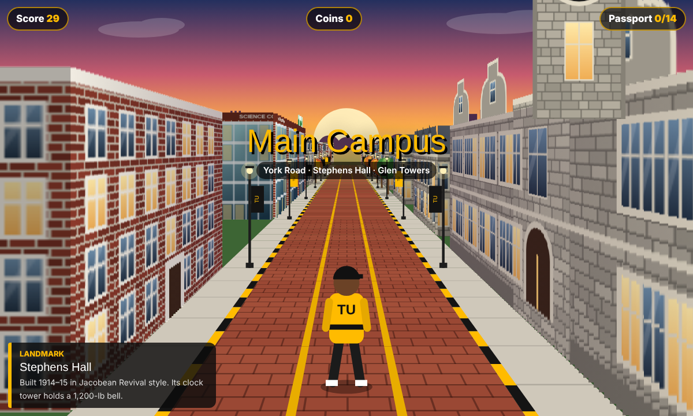

# 🐯 Towson Dash

An endless runner set in Towson, Maryland. You sprint down York Road past hand-drawn versions of real Towson University and uptown Towson landmarks, dodge barricades and TU shuttles, and collect gold stars. Each star unlocks a real thing to do around Towson.

**▶ Play it:** `https://<vasitymanito-byte>.github.io/towson-dash/` 

 <!-- add your own screenshot or GIF here -->

---

## Features

- **Three zones that loop as you run**
  - **Main Campus:** Stephens Hall (its clock tower shows your real local time), the Science Complex, Albert S. Cook Library and all four Glen Towers. The road is red brick with gold lane inlays.
  - **Uptown Towson:** the Towson Roundabout (an obstacle you have to steer around), Towson Town Center, the 1855 Courthouse, StarTUp at the Armory and 401 Washington Ave. The road is asphalt with crosswalks.
  - **Tiger Country:** SECU Arena and Johnny Unitas Stadium. The road is football turf with yard lines, and the sidewalks become a running track.
- **Landmark plaques:** a short real fact appears as you pass each building.
- **Towson Passport:** 14 activities to unlock, such as the Glen Arboretum, Hampton National Historic Site and Tigers football.
- **Leaderboard:** a top-10 board with name entry, kept in the browser.
- **Desktop and mobile:** play with the keyboard or with swipes.
- **No build step and no dependencies:** plain HTML, CSS and JavaScript on a `<canvas>`.

## Controls

| Action | Keyboard | Touch |
|---|---|---|
| Switch lanes | ← → or A / D | Swipe left / right |
| Jump | ↑, W or Space | Swipe up or tap |
| Slide | ↓ or S | Swipe down |
| Start / restart | Enter | Tap the button |

**Obstacles:** jump over the gold "TU" barricades. Slide under the "GO TIGERS" banners. Change lanes to get around TU Shuttles and the Roundabout.

## Run it locally

Option 1: double-click `index.html`. It works straight from your file system.

Option 2: run a local server, which is closer to how it behaves once hosted:

```bash
cd towson-dash
python3 -m http.server 8000
# open http://localhost:8000
```

## Deploy to GitHub Pages

1. Create a new public repo named `towson-dash` and push this folder to it:
   ```bash
   git init
   git add .
   git commit -m "Initial commit: Towson Dash"
   git branch -M main
   git remote add origin https://github.com/<your-username>/towson-dash.git
   git push -u origin main
   ```
2. On GitHub, open **Settings → Pages**. Under **Source**, choose **Deploy from a branch**, then **main** and **/ (root)**. Click **Save**.
3. After about a minute, the game is live at `https://<your-username>.github.io/towson-dash/`.

## Project structure

```
towson-dash/
├── index.html          # Page layout: canvas, HUD, menus, script tags
├── css/
│   └── style.css       # HUD, overlays, leaderboard styling
└── js/                 # Classic scripts loaded in this order
    ├── core.js         # Constants, activity data, canvas, projection P()
    ├── textures.js     # Building facades drawn into offscreen canvases
    ├── landmarks.js    # Landmark names, facts, and positions on the route
    ├── screen.js       # Sky and skyline backdrop, resize handling
    ├── world.js        # Game state, street generation, spawning, physics, collisions
    ├── input.js        # Keyboard and touch controls, HUD popups
    ├── render.js       # Per-frame drawing: ground, buildings, props, obstacles, player
    ├── leaderboard.js  # High-score storage adapter and rendering
    └── main.js         # Menus, start / game over, boot
```

The scripts share globals and load in order, so there's no bundler. Because of that, the order of the `<script>` tags in `index.html` matters.

## How it works

### 1. Fake 3D with one projection function
The world uses simple coordinates: `x` is the lane (−1, 0, 1), `z` is the distance ahead of the player, and `h` is the height. `P(x, z, h)` in `core.js` converts a world point to a screen point with a perspective divide:

```js
s = F / (F + z)          // shrinks as things get farther away
screenX = centerX + x * laneWidth * s
screenY = horizon + (groundY - horizon) * s - h * laneWidth * s
```

Everything on screen (road, buildings, shuttles, the player) is drawn by projecting world points through `P()` and filling shapes between them.

### 2. Building facades as textures
Each landmark facade is painted once into an offscreen canvas at startup (`textures.js`). That includes Stephens Hall's stone and curved gables, the Courthouse's columns and pediment, and the Glen Towers' window grid. A side wall that recedes into the distance is a trapezoid, and a 2D canvas can't map an image onto a trapezoid directly. So the wall is drawn in thin vertical strips, Wolfenstein-style, and each strip is a slice of the texture scaled to that depth. Stephens Hall's clock tower is a separate sprite that always faces the camera, and its hands are drawn every frame from `new Date()`.

### 3. A streaming street
The route repeats every 840 world units (Campus → Uptown → Tiger Country). `world.js` keeps a cursor for each side of the street and fills ahead of the player. If a scheduled landmark is coming up, it gets placed. Otherwise a random building that fits the current zone goes in: stone halls and brick dorms on campus, storefronts uptown, fences and bleachers in Tiger Country. Buildings behind the player are removed.

### 4. Gameplay loop
`requestAnimationFrame` drives `update(dt)` and then `draw()`. The frame time `dt` is capped at 50 ms so a lag spike can't teleport you through an obstacle. Speed climbs with distance. A collision happens when an obstacle overlaps the player's depth and lane, unless the player is high enough (barricades) or sliding (banners).

## Leaderboard

Scores are saved in **`localStorage`**, so each browser keeps its own top 10. That works on GitHub Pages with no server.

### Making the leaderboard global
`leaderboard.js` puts all storage behind a small adapter:

```js
const Leaderboard = {
  async load()        { /* return [{id, name, score, stars, date}, ...] sorted high to low */ },
  async submit(entry) { /* save entry, return the updated top 10 */ }
};
```

To share scores across everyone who plays, write a new adapter that calls a backend (Firebase Firestore, Supabase, or a small Express API) and change one line:

```js
const Leaderboard = LocalBoard;   // → const Leaderboard = SupabaseBoard;
```

Before you go public with a global board, validate scores on the server. Anyone can call your API with a fake score, so at minimum cap the maximum score and rate-limit submissions.

## Dev flags

Add these to the URL while testing:

| Flag | Effect |
|---|---|
| `?god` | No collisions |
| `?warp=300` | Start 300 units in (`300` = Uptown, `600` = Tiger Country) |
| `?autostart` | Skip the menu |

Example: `index.html?god&autostart&warp=600`

## Ideas for next steps

- Global leaderboard (see above)
- Sound effects and a fight-song-style loop
- Power-ups: coin magnet, a Tiger sprint boost, a shield
- More landmarks: Burdick Hall, the Center for the Arts, West Village, Hampton Mansion
- A character picker and unlockable outfits
- Unit tests for the collision and spawning logic

## Credits

- Built by **Ivan Addico**, Towson University.
- Developed with help from Claude (Anthropic).
- The buildings are original drawings based on each landmark's real architecture. No photos are used.
- Landmark facts come from Towson University, the Maryland Historical Trust and the National Register of Historic Places. Activity hours and dates change, so check official sites before you visit.
- Fonts: [Bungee](https://fonts.google.com/specimen/Bungee) and [Rubik](https://fonts.google.com/specimen/Rubik) via Google Fonts.

This is a fan project and isn't affiliated with or endorsed by Towson University.
